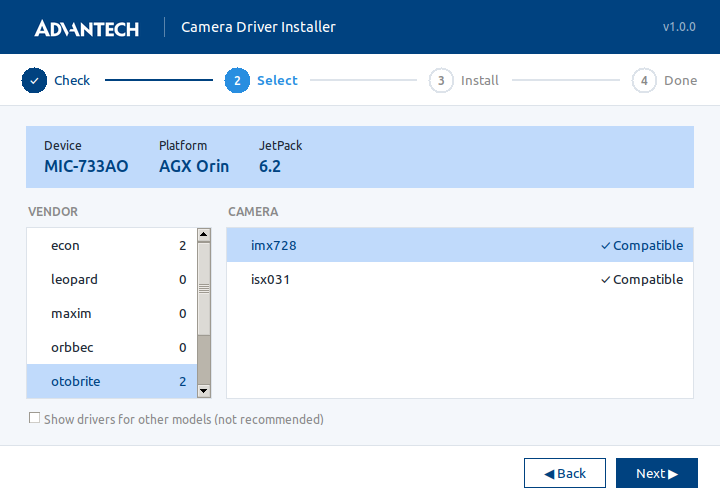
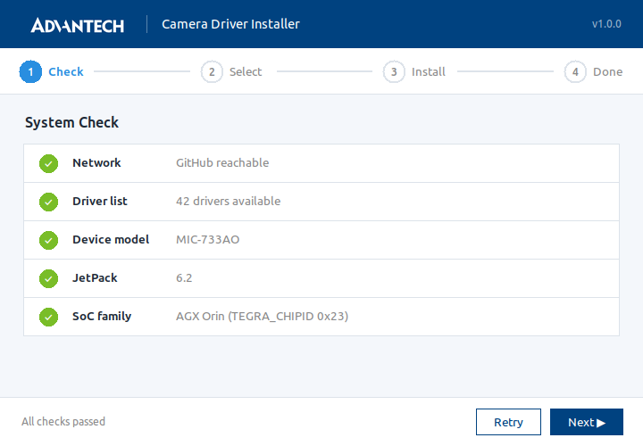
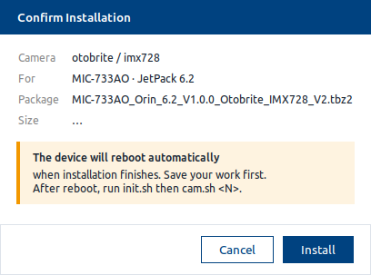
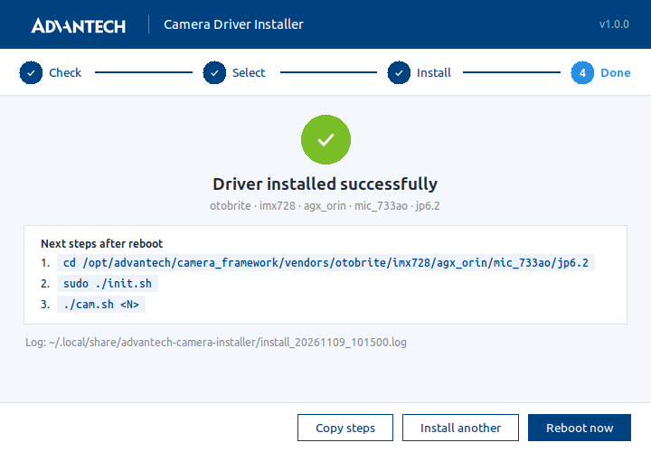

# Camera Driver Installer for MIC-AI Series

A desktop app that installs the right camera driver for your Advantech MIC-AI system. It detects your board and JetPack version, shows only the drivers that match, then downloads, verifies and installs the one you pick.

Driver packages are downloaded from [MIC-AI-camera-driver](https://github.com/advantech-edge-ai/MIC-AI-camera-driver), the download center for Advantech MIC-AI camera drivers. This app is a graphical alternative to the auto-install script in that repository.



## Requirements

- An Advantech MIC-AI system running the **Advantech BSP image** with **JetPack 6.x or 7.x** (the app reads the board model and JetPack version from `/opt/version`)
- Supported boards:
  - Orin Nano / Orin NX: MIC-711, MIC-712AR, MIC-713
  - AGX Orin: MIC-732, MIC-733AO
  - AGX Thor: MIC-741, MIC-742, MIC-743, MIC-743RB
- Internet access to `github.com`
- An account with administrator (`sudo`) permission

> MIC-735AR (IGX 2.0) has not been verified with this app yet. Please use the auto-install script in [MIC-AI-camera-driver](https://github.com/advantech-edge-ai/MIC-AI-camera-driver) for that system.

## Install

Open a terminal on the MIC-AI system and run:

```bash
wget -O /tmp/advantech-camera-installer_all.deb \
  https://github.com/advantech-edge-ai/MIC-AI-camera-installer/releases/latest/download/advantech-camera-installer_all.deb
sudo apt install /tmp/advantech-camera-installer_all.deb
```

This always installs the latest version. Older versions are available on the [Releases](https://github.com/advantech-edge-ai/MIC-AI-camera-installer/releases) page.

## Quick Start

Open **Advantech Camera Driver Installer** from the application menu, or run `advantech-camera-installer` in a terminal.

**1. Check**

The app checks the network connection and detects your system. If a check fails, the app tells you what to do; fix it and click **Retry**.



**2. Select**

Select the camera **Vendor**, then the **Camera**. Only drivers that match your board and JetPack version are listed (see [Device Check](#device-check)). Click **Next**.

**3. Install**

Review the confirmation and click **Install**. Enter your password when the system asks for administrator permission. The app downloads the driver package, verifies it, and runs its installer.



> **The system reboots automatically** when the driver installation finishes. Save your work before you click **Install**.

**4. Start the camera**

After the reboot, open the app again. It shows the steps for your driver, for example:

```bash
cd /opt/advantech/camera_framework/vendors/<vendor>/<sensor>/<platform>/<board>/<jetpack>
sudo ./init.sh     # load the camera driver (run again after every reboot)
./cam.sh 0         # show the image from /dev/video0
```

`cam.sh` opens a preview window, so run it from the system's desktop (not over SSH). The number is the video device index (`/dev/video0`, `/dev/video1`, ...). Click **Copy steps** to copy the commands.



## Device Check

| Driver package | What the app does |
|---|---|
| Matches your board, JetPack, and SoC | Listed as **✓ Compatible** |
| Shared package for your board (MIC-741 and MIC-743 can use MIC-742 packages) | Listed as **✓ uses MIC-742 package** |
| For a different SoC (for example, a Thor package on an Orin system) | **Never listed** |
| For a different board or JetPack version | Hidden. Shown only when you tick **Show drivers for other models**, marked ⚠, and you must confirm again before installing |

If the app cannot detect your board or JetPack version, no driver is marked compatible and drivers for other models are shown with a warning.

**Do not install a driver marked ⚠ unless you are sure.** A driver built for a different board or JetPack can leave the camera not working or the system unable to boot.

## Using the App over SSH

When there is no desktop (for example, over SSH), `advantech-camera-installer` shows a text menu with the same steps and checks. Enter `0` in any menu to go back or exit. To use the text menu on a desktop as well, run `advantech-camera-installer --tui`.

## Notes

- **Install one camera driver per system.** Installing a second driver, or the same driver again, may conflict with the previous one. To change to a different camera, reflash the Advantech BSP image first.
- Packages without a published checksum are installed with the MD5 step marked **Not verified**.
- If your network uses a proxy, start the app from a terminal with the proxy set, for example `https_proxy=http://proxy.example.com:8080 advantech-camera-installer`.
- During `apt install` you may see `Download is performed unsandboxed as root ...`. This is a normal apt notice and does not affect the installation.

## Uninstall

```bash
sudo apt remove advantech-camera-installer
```

Camera drivers installed with the app are not removed.

## Questions

If you have questions about this app, or an installation does not work, please open an [Issue](https://github.com/advantech-edge-ai/MIC-AI-camera-installer/issues) in this repository. Attach the log file shown in the app; logs are saved in `~/.local/share/advantech-camera-installer/`.

For questions about a camera driver package itself, please open an Issue in [MIC-AI-camera-driver](https://github.com/advantech-edge-ai/MIC-AI-camera-driver/issues).

## Next Step

After you successfully integrate cameras, you might be interested in browsing the [Advantech Solution Pilot](https://github.com/advantech-EdgeAI). It is a set of software services built on the MIC-AI series, offering an intuitive and flexible SDK compatible with JetPack 6.0 and above.

> [!TIP]
> Want to get the latest news and updates? [Subscribe to our newsletter](https://subscribe.advantechsae.online/)


